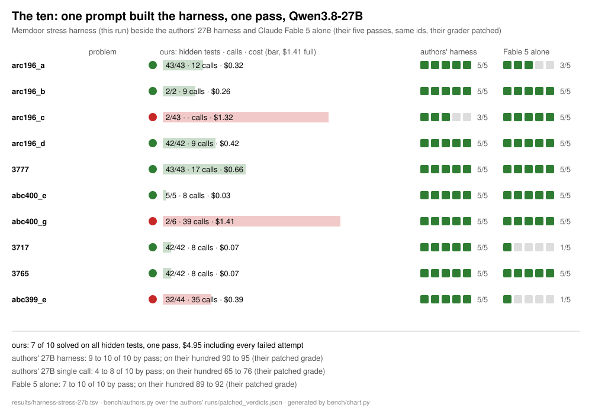

# memdoor-demos

Things built with [Memdoor](https://github.com/guregodevo/memdoor) from one prompt, with the
bill and the result measured. Nothing here is a scripted animation: every number below comes
from a run on a gateway whose ledger (`~/.memdoor/meter.jsonl`) stamps each call with the run
that made it.

## 1. The GVS5H harness from one prompt

The paper "Five Qwen3.8-27B models match Claude Fable 5 on LiveCodeBench"
([GVS5H](https://github.com/GVS5H)) runs one 27B model in fresh contexts as five roles sharing a
ledger on disk: a primary that plans, an ideation worker, a manager, a worker and a summarizer,
with the public samples as ground truth, for up to ten rounds. Their harness is a Python
program (`escalation/multiagent.py`).

Here the same harness is a Memdoor **workflow**: one YAML task per role per round, the ledger
passed between tasks through files and `requires`, no orchestrator code. Memdoor's coder wrote
all of it from one prompt.

### One prompt builds it

`prompts/build.md` (six lines; `prompts/build-long.md` is the spelled-out version the first
build used):

```
Reproduce the GVS5H harness in <path to>/escalation/multiagent.py
as a workflow named gvs5h: five agents of one model sharing a ledger on disk, the
manager and worker alternating for up to ten rounds with the public samples in tests/
as ground truth, keeping the file's roles, prompts and loop. Every role runs on
`openrouter:qwen/qwen3.8-27b thinking high order modal,coreweave,parasail,wafer`.
Then run it on the problem in this folder and show me the ledger.
```

Typed into `memdoor tui` in a folder holding one problem (`task.md`, `tests/N.in`,
`tests/N.out`). The coder reads the paper's file, loads Memdoor's `workflow` skill and writes
`.memdoor/workflows/gvs5h/`: 78 tasks (the long prompt) or 24 (the short one). `workflow/gvs5h`
is the build as it ran, with the handful of lines later runs proved wrong fixed by hand
(listed in `workflow/gvs5h/README.md`).

### One prompt solves a problem

`prompts/solve.md`:

```
/workflow:gvs5h
```

In the problem's folder. The run leaves `solution.py`, `plan.md`, `notes.md`, `tasks.json`, the
per-round manager and worker replies, and `test-status.txt`.

Every task's model line is

```
model: openrouter:qwen/qwen3.8-27b thinking high order modal,coreweave,parasail,wafer max_tokens 128000
```

`order` keeps the call on hosts that serve the model with a 128K output window;
`max_tokens 128000` is the paper's setting (without it one problem's worker thought for 434K
tokens on a 235K host and cost a dollar).

### What is measured so far

LiveCodeBench problems, the authors' own hundred ids (`bench/ids.json`), graded on the
public samples and on all the hidden tests with `bench/grade.py`. Prices are OpenRouter's list
prices as billed.

**The harness, 27B, thinking high, no output cap** (`results/harness-27b-ten-partial.tsv`;
a batch of ten stopped after six because of the bill):

| problem | done at round | calls | tokens in / out | cost | public samples | all tests |
|---|---|---|---|---|---|---|
| arc196_a | 2 | 6 | 8720 / 32110 | $0.074 | 3/3 | 4/43 |
| 3777 | never | 33 | 86197 / 145634 | $0.338 | 3/3 | 43/43 |
| abc400_e | 2 | 6 | 10522 / 6875 | $0.016 | 1/1 | 5/5 |
| arc196_c | stopped in round 1 | 11 | 15090 / 434019 | $0.999 | - | - |
| arc196_d | 2 | 9 | 22536 / 204729 | $0.472 | 2/2 | 2/42 |
| arc196_b | 2 | 7 | 14014 / 77094 | $0.178 | 1/1 | 2/2 |

3 of 6 solved, $2.08. The authors' harness solves all six in four of their five passes
(`bench/authors.py` on their `runs/patched_verdicts.json`). Their 27B single call solves them
too in most passes, so these six say little yet about harness versus single call.

**One problem, three harness runs** (abc383_e, which the authors solve in every pass):

| run | rounds | calls | cost | all tests |
|---|---|---|---|---|
| first build, no guard on a round after done | 2 (then 8 idle rounds) | 33 | $0.27 | 42/42 |
| rounds after done skipped by a guard | 2 | 9 | $0.108 | 42/42 |
| same, with `when:` conditions | 10, never done | - | $0.35 | 0/42 |

**The single call, 27B, thinking high** (`results/single-27b-thinking-24.tsv`): 21 of 24
problems solved on all tests, one call each, $0.62 (about 2.6 cents a problem). The authors' single call:
77 to 80 of 100 (82 to 86 with their grader patch), five passes.

**Earlier, thinking off, all hundred** (`results/*-thinking-off-100.tsv`): the single call and
Memdoor's own `team-solve` workflow, before the GVS5H build; kept for the record.

### Round two: a stress test as ground truth (2026-10-27)

Both batch failures said done with the public samples green and failed 39 and 40 hidden
tests. `prompts/improve.md` asked the coder for a brute-force check as the ground truth
for done, built from standard tasks only: a brute-force reference and a random generator
written once, a command task per round that diffs the solution against the brute force on
200 small inputs with a 2 s limit, gated with `when:` on that round's samples passing, and
the next manager reading the mismatch as a failing test. Thinking high stays on the workers
only. `workflow/gvs5h-stress` is the result (92 tasks); one line per round that the first
run proved wrong was fixed by hand (the manager read its own round's sample verdict instead
of the previous one's).

| problem | harness, samples only | harness, samples + stress |
|---|---|---|
| arc196_a | done at round 2, 4/43, $0.074 | round 1: samples 3/3, stress FAILED on input 5 of 200; round 2: samples 3/3, stress ok, done; **43/43**, 12 calls, $0.32 |
| arc196_d | done at round 2, 2/42, $0.47 | round 1: samples 2/2, stress ok, done at round 2; **42/42**, 9 calls, $0.42, 18 min |

The authors' harness solves both in all five passes.

### The ten (2026-10-28)

The same ten ids as the authors' first ten, one at a time, 27B, thinking high, 128K cap,
through `workflow/gvs5h-stress` (`results/harness-stress-27b.tsv`, with each problem's
note). The authors' columns are their five passes on the same id (`bench/authors.py`).

| problem | ours | authors' 27B harness | Fable 5 alone |
|---|---|---|---|
| arc196_a | 43/43 | 5/5 | 3/5 |
| arc196_b | 2/2 | 5/5 | 5/5 |
| arc196_c | 2/43 | 5/5 | 5/5 |
| arc196_d | 42/42 | 5/5 | 5/5 |
| 3777 | 43/43 | 4/5 | 5/5 |
| abc400_e | 5/5 | 5/5 | 5/5 |
| abc400_g | 2/6 | 5/5 | 5/5 |
| 3717 | 42/42 | 5/5 | 1/5 |
| 3765 | 42/42 | 5/5 | 1/5 |
| abc399_e | 32/44 | 5/5 | 1/5 |



**7 of 10**, $4.95 including every failed attempt, one pass. Their harness: 10 of 10 in
four passes of five. Fable 5 alone: 7 to 9 of 10 by pass. What the three misses taught,
each fixed in the workflow or the gateway before the next run:

- **arc196_c**: the plan call came back empty four times, 19K to 51K tokens of reasoning
  and no answer. The gateway now asks an llm task again without thinking when that
  happens; the plan landed on the third attempt. Then the brute force crashed and the
  harness blamed the solution for three rounds; a crashing reference now reads
  INCONCLUSIVE and the worker rewrites it.
- **abc400_g**: the stress test refused the solution in nine rounds of ten and the hidden
  grader agreed. The harness knew; the 27B did not find it. The one honest loss.
- **abc399_e**: the manager never said done, the late rounds timed out in the stress step,
  the final worker's answer went out unchecked.
- **3777, 3717, 3765** are LeetCode-style problems, graded by calling a method. The rig
  had no sample files for them until this batch: `bench/functional-tests.py` and the
  driver `run.sh` / `run-solution.py` in the workflow fix that for all 27 of the hundred.

The hundred is next, one pass, at the rate above between $15 and $25.

### What is not apple to apple yet

- **Grader**: `bench/grade.py` runs the hidden tests as they ship in LiveCodeBench; the authors
  patched their verdicts (`old_pass@1` vs `new_pass@1`). Our pass counts are the raw kind.
- **Serving**: the authors ran the model on their own hardware; here the calls go to whichever
  OpenRouter host answers first among four. Throughput and the output window differ by host.
- **Output cap**: the ten-problem batch ran before `max_tokens 128000` existed; the paper's
  runs had 128K. The stress-test runs carry the cap.
- **Sample size**: six and twenty-four problems, one pass. Their numbers are a hundred problems,
  five passes.

### Run it yourself

Needs Memdoor with a key for the model (`memdoor connect openrouter`), Python 3, and the
LiveCodeBench problems materialised into `bench/problems/<id>/` (`bench/materialize.py`).

```
bench/run-one.sh workflow/gvs5h abc383_e      # one problem, graded, its row in results/
bench/report.py gvs5h --md                     # the table above, from results, logs and the ledger
bench/authors.py <GVS5H>/runs/patched_verdicts.json abc383_e   # their verdicts for the same id
```

Run one problem and read its receipt before a batch: a harness with thinking on costs between
two cents and a dollar a problem.
